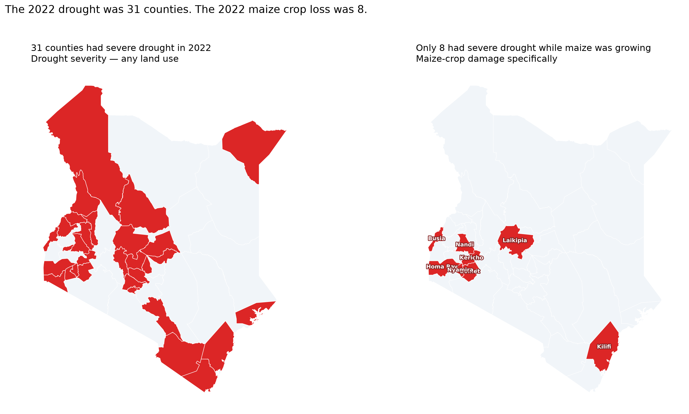
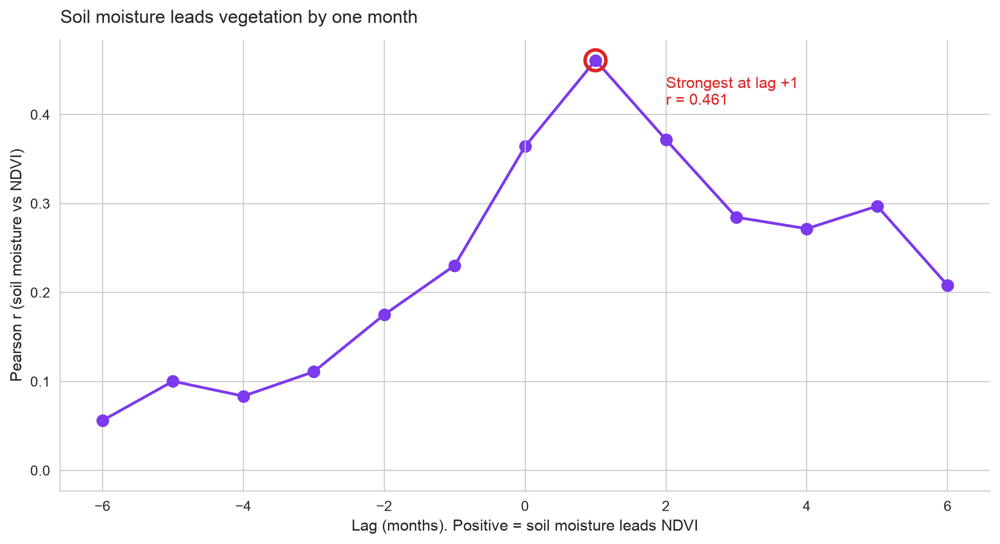

# A County-Level Drought Monitor for Kenya: Detecting Crops at Risk

**Author:** Alex Haro Nyandega  
**Date:** October 2026  
**Contact:** alex@kenyaclimatelab.me  

---

## Context
Kenya’s agricultural sector is highly vulnerable to climate shocks, yet national drought statistics often publish only after the harvest is lost. Existing tools either lack the resolution to inform localized crop decisions or operate on a delay that makes timely intervention impossible. This project introduces a county-level drought and vegetation stress monitor that provides timely environmental risk assessments across all 47 Kenyan counties using open-source satellite data.

## Data & Method
The monitor ingests three open datasets: CHIRPS rainfall estimates, Sentinel-2 vegetation health (NDVI), and ERA5-Land soil moisture. For every county-month, a composite stress index is computed by calculating the standardized anomaly against the county’s own historical climatology. The index weights vegetation at 65% and rainfall at 35%, requiring no calibration or training data. A crop-stage weight is then applied, so stress during maize planting or vegetative stages is weighted more heavily than stress during the fallow period.

## Key Findings

**1. Drought Does Not Equal Crop Failure.**  
In 2022, the monitor identified severe drought in 31 counties. However, when cross-referenced with the crop calendar, only **8 of those 31 counties** experienced severe drought while maize was actively growing. The remaining 23 counties had already harvested. This distinction is critical for targeting agricultural relief: drought severity and crop damage are entirely different metrics.

**2. Soil Moisture Provides an Early Warning Signal.**  
Analysis of 4,252 county-months revealed that topsoil moisture anomalies precede vegetation anomalies by approximately one month (r = 0.461, 95% CI [0.436, 0.485]). By monitoring soil moisture, decision-makers can anticipate vegetation collapse and crop failure four weeks before it appears in satellite imagery.

**3. A Documented Null Result.**  
An attempt to extend the monitor to predict maize yield loss returned a null result. No tested formulation of the stress index predicted county-level yield loss at a level distinguishable from noise (partially due to unmodeled shocks, such as the 2022 fall armyworm outbreak in Kakamega). Therefore, the tool is explicitly scoped as a drought and vegetation monitor, not a yield predictor. It tells decision-makers *where to look*, not *how many bags of maize were lost*.

## Recommendations
1. **For County Agriculture Officers:** Use the crop-weighted index to prioritize county-level extension visits during the long and short rains. The tool's early-warning capability (soil moisture) can guide pre-emptive resource allocation.
2. **For Policymakers:** Cross-reference current national drought declarations with the monitor's 31-vs-8 finding to ensure relief funding targets regions that actually experienced crop failure, not just meteorological drought.
3. **For Researchers:** The soil-moisture lead-lag relationship should be further investigated using deeper agronomic variables (e.g., DSSAT or RHEAS models) to bridge the gap between environmental stress and yield loss.

## Limitations
The monitor operates at monthly resolution using county averages, which mask sub-county variation. It is validated against a single drought event (2022). The index cannot capture non-climatic shocks such as pests or market failures. All code, data, and methodology are open-source (MIT license).
